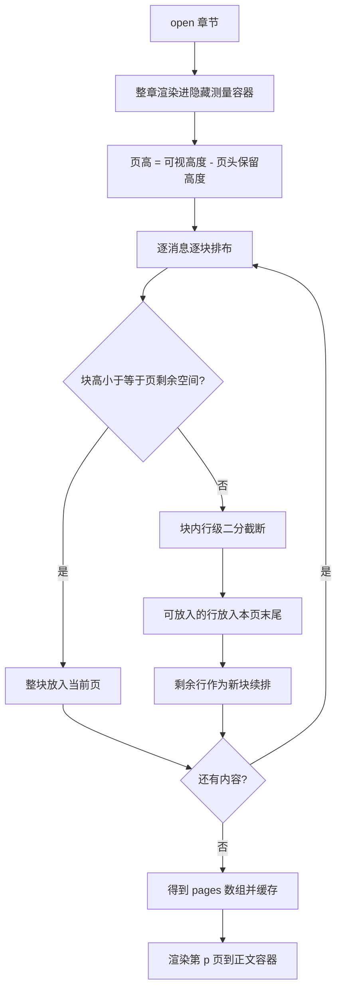

# 新增「翻页」阅读方式

## 需求

1. 阅读方式新增「翻页」：正文区每次只显示**一页**的内容，翻页时整页切换（页内不滚动）。
2. 翻页阅读时，章节标题「第N章」后追加 **（1/N）**，N 为该章节被切分出的总页数。
3. 底部栏在「上一章 / 下一章」之间插入「← →」翻页按钮，布局为：

   ```
   上一章  ←  →  下一章
   ```

## 关键约束（用户澄清）

- 一章主要由 **1~2 条消息**组成：一条 user + 一条 char（用户取消勾选「显示用户回复」时仅一条 char）。
- 因此**必须支持把单条长消息按屏幕高度拆成多页**（文本行级切分，保留 HTML 结构）。若按「消息不跨页」分页，一章只会分出 1~2 页，翻页功能失去意义。

---

## 现状梳理

### 设置层

- 阅读方式 `readerSettings.readMode`：`"paged"`（分页=整章+滚动跳章，默认）与 `"scroll"`（连续滚动）。
- 设置面板在 [`index.js`](index.js:3337)，`modeOptions = [{paged, 分页}, {scroll, 滚动}]`；切换后关闭面板并 `openChapter` 重开当前章。

### 正文渲染

- [`features/reader/index.js`](features/reader/index.js)：
  - `buildChapterHeader` 构建章标题（`N / 总章数` + `第N章 章节名`），供单章与滚动块复用（私有函数）。
  - `renderChapter` 整章渲染进 `.novel-reader-scroll`（滚动容器，可滚动）。
- [`features/reader/render.js`](features/reader/render.js)：
  - `renderMessagesBatched` 分批渲染消息，内部维护 `swipeRefs` 并调用 `bindSwipeBarEvents` 绑定版本切换（**事件绑定在 `.novel-msg-list` 容器上**）。

### 底部栏

- [`index.js`](index.js:638)：`首页 目录 上一章 下一章 书签 界面`；prev/next → `goChapter(±1)`。

### 打开章节 / 跳章

- `openChapter` / `openChapterAtMessage` / `goChapter`：按 `isScrollReadMode()` 分叉，`paged` 走 `reader.renderChapter`（每次重建滚动容器）。

### 进度

- `progress.save` 字段：`chapter / msgId / index / scrollTop / updatedAt`。

---

## 方案设计

### 1. 新增模式枚举与设置

- `readerSettings.readMode` 新增值 `"flip"`（翻页）；`isFlipReadMode()`。
- 设置面板 `modeOptions` 增加 `{ id: "flip", text: "翻页" }`，注释同步更新。

### 2. 新增翻页核心 [`features/reader/flip.js`](features/reader/flip.js)（新文件）

`createFlipReader(deps)`，deps：`reader`、`onCurrentChapterChange`、`onPageChange`、`onRenderedPage`。

**分页算法：测量驱动 + 块级优先 + 行级二分兜底（保留 HTML 结构）**



要点：

- **页 = 页头（章标题 +（p/N））+ 若干行级片段**。
- **块级单元**：消息的顶层块元素（`p / div / pre / blockquote / ul / ol / table / img / iframe / hr / .novel-html-app` 等）。
  - 不可分割元素（img / iframe / pre / table / HTML 应用）：整块搬移，放不下则独占一页或移入新页。
  - 文本块：超高时**行级二分**切分（保留行内格式）：
    - 收集块内 TextNode，用 `Range` + `cloneContents()` 逐行取出「恰好一行的片段」（二分字符定位），贪心装入页容器，剩余行续排。
    - `cloneContents()` 保留粗体 / 链接 / 行内代码等行内格式。
- **页头**：复用 `buildChapterHeader`，首行显示 `第N章（p/N）`，副行保持 `N / 总章数 章`。
- **分页结果缓存**：`pages`（每页 = 片段列表，引用测量容器中的节点）；翻页 / 跳页直接渲染对应页。
- **显示阶段**：把该页片段克隆进 `.novel-flip-page`（固定高度、`overflow:hidden`、不滚动），并调用 swipe 绑定逻辑。

**swipe 版本切换与翻页的交互**：

- 章节消息少（1~2 条），swipe 切换后**整章重新分页**成本极低。做法：swipe 切换 → 触发 `flipReader.relayout()` 重排 → 回到「该消息所在页」附近。
- swipe 切换条：在「该消息任一页片段」上都显示（每页一独立容器，事件绑定同滚动模式）。

**尺寸变化重排**：

- 字号 / 主题 / 窗口尺寸变化（`applyReaderStyles` 后）→ `relayout()` 重新分页，尽量回到原页码附近。
- 图片加载、HTML 应用 iframe 高度同步等引起的页内容高度变化 → 在正文容器内挂 **ResizeObserver**（监听内容尺寸变化），防抖后 `relayout()`。

### 3. [`features/reader/index.js`](features/reader/index.js) 调整

- 导出 `buildChapterHeader`（新增可选参数 `pageText`，翻页模式传入 `（p/N）`）。
- 新增 `renderChapterForMeasure`（或让 flip.js 复用渲染管线）：把整章消息渲染进「隐藏测量容器」并返回节点列表，供分页测量（宽度与正文一致，高度不限）。

### 4. [`features/reader/render.js`](features/reader/render.js) 调整

- `renderMessagesBatched` 返回 `swipeRefs`（由 `Promise<void>` 改为返回 Map，现有调用方不受影响）。
- 导出 `bindSwipeBarEvents`（供 flip 模式对每页容器复用）。
- 新增 `renderMessagesForMeasure(deps, messages, options)`：渲染消息 DOM（不限高度）供分页测量。

### 5. [`features/progress/index.js`](features/progress/index.js) 调整

- `save / load` 增加可选字段 `page`（翻页页码；旧数据为 undefined，翻页模式按第 1 页恢复）。

### 6. [`index.js`](index.js) 集成

- `isFlipReadMode()`；惰性 `flipReader = createFlipReader({...})`，回调更新 `state.currentChapter` / 页码 / 底部按钮 / 进度保存。
- `openChapter` / `openChapterAtMessage` / `goChapter` 增加 flip 分支：不重建滚动容器，`flipReader.open(scroll, chapterIndex, page)`。
- 进度：flip 模式由翻页回调保存 `{chapter, page}`（不监听 scroll）；恢复时读 `saved.page`。
- `applyReaderStyles` 后调用 `flipReader.relayout()`（字号 / 主题变化重排）。
- 离开正文页 / 关闭阅读器：`flipReader?.destroy()`（与 `scrollReader` 一致，在 [`setPage`](index.js:888) 与关闭逻辑处）。
- 底部栏（[`index.js`](index.js:638)）在 `prev` 与 `next` 之间插入：

  ```html
  <button class="novel-btn novel-page-btn" data-action="prev-page" title="上一页">←</button>
  <button class="novel-btn novel-page-btn" data-action="next-page" title="下一页">→</button>
  ```

- 事件：`prev-page` / `next-page` → `flipReader.pageBy(±1)`。
- `updateBottomButtons`：非 flip 模式隐藏这两个按钮；flip 模式显示并按页码禁用边界（第 1 页禁 ←，最后 1 页禁 →；N=1 时两钮同时禁用）。

### 7. [`style.css`](style.css) 样式

- `.novel-flip-page`：固定高度、`overflow:hidden`、不滚动；`.novel-reader-scroll` 在 flip 模式下 `overflow:hidden`。
- 页头样式复用 `.novel-chapter-title`。
- `.novel-page-btn`：复用 `.novel-bottombar .novel-btn` 基础样式，略窄。
- 移动端媒体查询同步补充。

---

## 边界与兼容

| 场景                                                   | 处理                                          |
| ------------------------------------------------------ | --------------------------------------------- |
| 单条长消息                                             | 行级二分切分为多页，保留行内格式              |
| 不可分割元素（img / iframe / pre / table / HTML 应用） | 整块搬移，放不下独占一页                      |
| 章节消息很少（1~2 条）                                 | 分页后仍可得到多页（长消息拆页），符合预期    |
| swipe 版本切换                                         | 切换 → 整章重排（成本低）→ 回到该消息所在页   |
| 图片 / iframe 高度变化                                 | ResizeObserver 防抖重排                       |
| 字号 / 主题 / 窗口变化                                 | `applyReaderStyles` 后 `relayout()`           |
| 搜索结果跳转 `openChapterAtMessage`                    | 定位章节后，尽量定位到含该消息的页            |
| 进度恢复                                               | 存 `page`，重开回到该章该页                   |
| 番外章                                                 | 与主线一致参与翻页与页码（沿用 displayIndex） |

## 涉及文件

- 新增：`features/reader/flip.js`
- 修改：`index.js`、`features/reader/index.js`、`features/reader/render.js`、`features/progress/index.js`、`style.css`
- 可选：`README.md`（「阅读设置」补一句翻页）

## 测试清单

1. 设置「翻页」→ 正文单页显示、页头「第N章（1/N）」；长 char 消息被拆成多页。
2. ← → 翻页：页码更新、边界（第 1 页 / 最后 1 页）按钮禁用。
3. 章节跳转（目录 / 书签 / 搜索）：进入正确章节并尽量回到目标页。
4. 字号 / 主题切换：重新分页且页码变化合理。
5. 进度：重开阅读器回到上次的章 + 页。
6. swipe：翻页后版本切换条仍可点击，切换后重排回到该消息所在页。
7. 番外章翻页正常。
8. 含图片 / HTML 应用的章节：整块搬移不截断，高度变化后自动重排。
